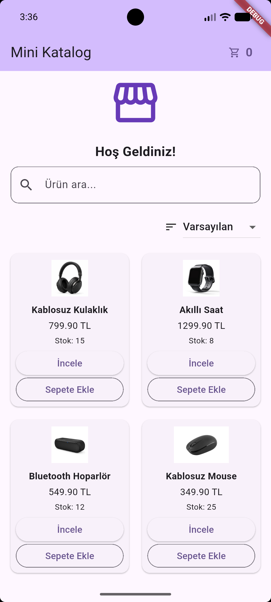
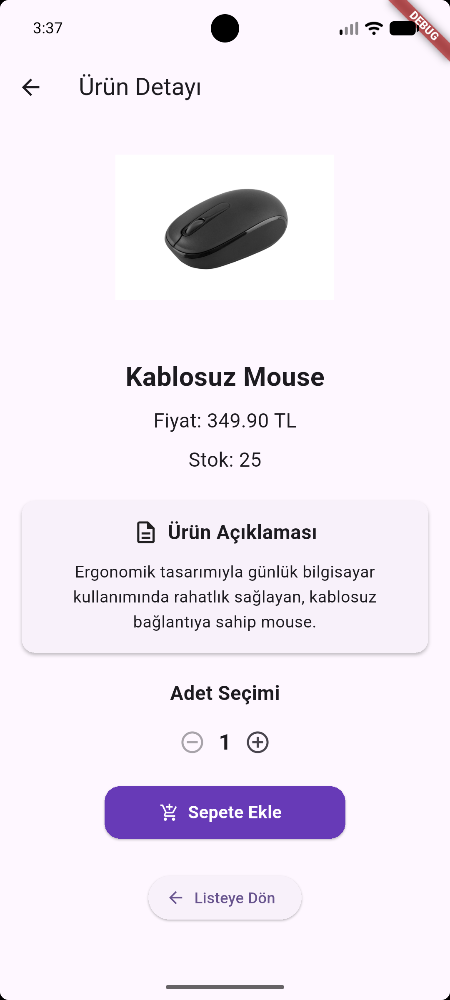
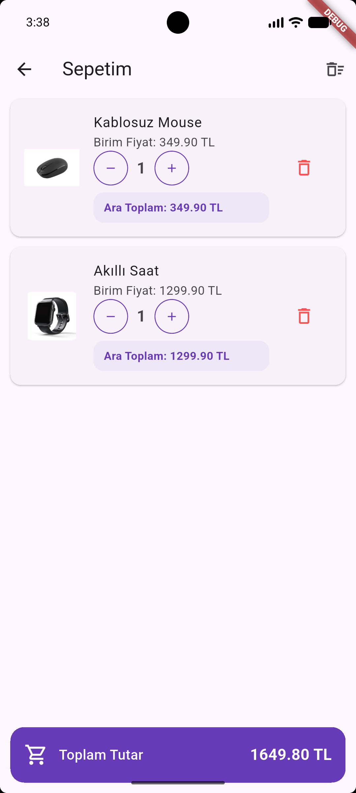

# Mini Katalog

Flutter ile geliştirdiğim basit bir ürün katalog uygulaması. Uygulamada ürünleri inceleyebilir, arama yapabilir ve ürünleri sepete ekleyebilirsiniz.

Bu projeyi Flutter ve Dart ile mobil uygulama geliştirme eğitimi kapsamında hazırladım.

## Özellikler

- GridView ile ürün listeleme
- Ürün arama ve fiyata göre sıralama
- Ürün detayları ve açıklamaları
- Adet seçerek sepete ürün ekleme
- Stok kontrolü
- Sepette ürün adedini artırma ve azaltma
- Sepetten ürün silme ve sepeti temizleme
- Sepet toplam tutarını hesaplama

## Kullanılan Teknolojiler

- Flutter 3.47.8
- Dart 3.13.7
- Material Design
- JSON

Ürün bilgileri yerel JSON dosyasından okunuyor. Sepet işlemleri uygulama içinde tutuluyor ve uygulama yeniden başlatıldığında sıfırlanıyor.

## Kurulum

Projeyi bilgisayarınıza indirdikten sonra klasörde terminal açın.

Bağımlılıkları yükleyin:

```bash
flutter pub get
```

Uygulamayı çalıştırın:

```bash
flutter run
```

VS Code üzerinden Android emülatörünü seçip `F5` ile de çalıştırabilirsiniz.

## Ekran Görüntüleri

### Ana Sayfa



### Ürün Detayı



### Sepet



## Not

Proje eğitim amacıyla geliştirilmiştir. Gerçek ödeme veya sipariş sistemi bulunmamaktadır.
